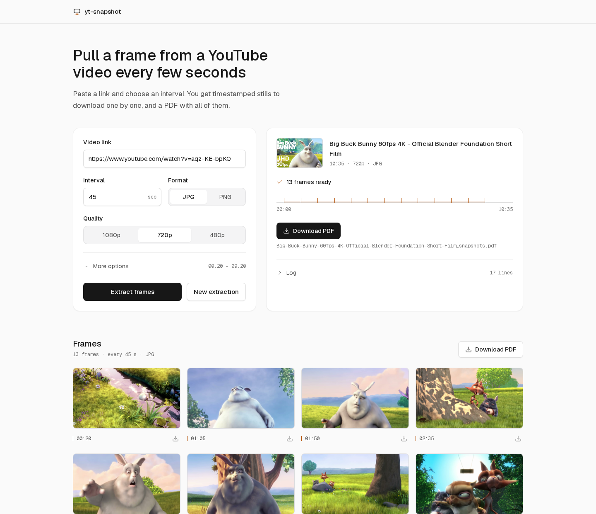

# yt-snapshot

Pull a frame from a YouTube video every few seconds. Paste a link, choose an
interval, and get timestamped stills you can download one by one, plus a PDF
with every frame. Built on [yt-dlp](https://github.com/yt-dlp/yt-dlp)
and [ffmpeg](https://ffmpeg.org).



## Features

- Frames at exact multiples of the interval, with filenames like `video-title_0010s.jpg`
- Optional start and end time, in seconds or as a timecode like `1:30`
- JPG or PNG, from a source capped at 1080p, 720p or 480p
- One PDF with every frame, one page per frame
- Optional contact sheet: every frame tiled into one image
- Live progress, with the backend log for each job
- Light and dark theme, following the system setting

## Requirements

- Node.js 20.9 or newer
- pnpm (`corepack enable` sets it up)
- yt-dlp, kept up to date, since YouTube changes often
- ffmpeg 5.1 or newer

## Quick start

```bash
pnpm install
cp .env.example .env.local   # optional, every setting has a default
pnpm dev
```

Open [http://localhost:3000](http://localhost:3000).

For a production server without Docker:

```bash
pnpm build
pnpm start
```

## Docker

The image bundles ffmpeg and the latest yt-dlp release.

```bash
docker build -t yt-snapshot .
docker run -p 3000:3000 -v yt-snapshot-data:/app/.data yt-snapshot
```

yt-dlp is fixed at build time, so rebuild the image (`docker build --no-cache`)
when YouTube downloads start failing. To pin a version, pass
`--build-arg YTDLP_VERSION=2026.03.17`. Settings from the table below can be
passed with `-e`, for example `-e MAX_FRAMES=500`.

## Configuration

All settings are optional environment variables. See [`.env.example`](.env.example).

| Variable | Default | What it does |
| --- | --- | --- |
| `YTDLP_PATH` | `yt-dlp` | Path to yt-dlp, if it is not on `PATH` |
| `FFMPEG_PATH` | `ffmpeg` | Path to ffmpeg, if it is not on `PATH` |
| `JOBS_TTL_MINUTES` | `60` | Minutes to keep a job's frames and PDF before deleting them |
| `MAX_FRAMES` | `300` | Most frames one job may produce. The PDF is built in memory, so keep this modest on small servers |
| `MAX_CONCURRENT_JOBS` | `2` | Jobs processed at the same time |
| `MAX_QUEUED_JOBS` | `20` | Jobs allowed to wait in line before new ones are turned away |
| `RATE_LIMIT_JOBS` | `5` | New jobs allowed per client IP in each window |
| `RATE_LIMIT_WINDOW_MINUTES` | `5` | Length of the rate limit window |
| `YTDLP_METADATA_MAX_CHARS` | `5000000` | Cap on yt-dlp metadata output. Raise it if metadata parsing fails |

## How it works

1. `POST /api/jobs` validates the request and puts the job in an in-process queue.
2. yt-dlp reads the video's metadata. The job fails early if it would exceed `MAX_FRAMES`.
3. yt-dlp downloads the video stream only, without audio, at the chosen height.
4. ffmpeg keeps the first frame at or after each multiple of the interval. This
   uses a `select` filter rather than `fps=1/N`, because `fps` takes the last
   frame of each window and lands about N/2 seconds late.
5. pdf-lib builds the PDF, and ffmpeg's `tile` filter makes the optional contact sheet.
6. Everything lives in `.data/jobs/<job-id>` and is deleted after `JOBS_TTL_MINUTES`.

## API

| Method and path                      | Description                                                                                                           |
| ------------------------------------ | --------------------------------------------------------------------------------------------------------------------- |
| `POST /api/jobs`                     | Starts a job. Body: `{ url, interval, start?, end?, format?, quality?, contactSheet? }`. Returns `202` with `{ job }` |
| `GET /api/jobs/:id`                  | Current state of a job, including progress, logs and output URLs                                                      |
| `GET /api/jobs/:id/download`         | The finished PDF                                                                                                      |
| `GET /api/jobs/:id/images/:filename` | A single frame or the contact sheet                                                                                   |

`interval`, `start` and `end` are whole seconds. `format` is `jpg` or `png`.
`quality` is `1080p`, `720p` or `480p`.

## Project structure

```
src/
  app/            Page, layout, global styles and the API routes
  components/     UI: form, capture plan, job panel, frame sheet, timeline
  lib/            Timecode helpers and the job polling hook
  lib/server/     Job store, queue, pipeline (yt-dlp, ffmpeg, PDF), validation
  types/          Shared job types
```

## Development

```bash
pnpm lint
pnpm typecheck
pnpm build
```

Issues and pull requests are welcome. Please run the three commands above
before opening a pull request.

## Responsible use

The screenshot above shows frames from
[Big Buck Bunny](https://peach.blender.org), © Blender Foundation, licensed
under [CC BY 3.0](https://creativecommons.org/licenses/by/3.0/).

## License

[MIT](LICENSE)
